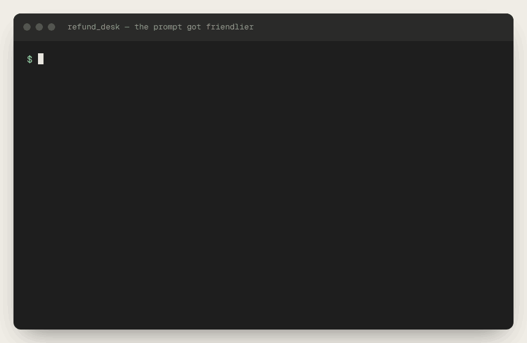
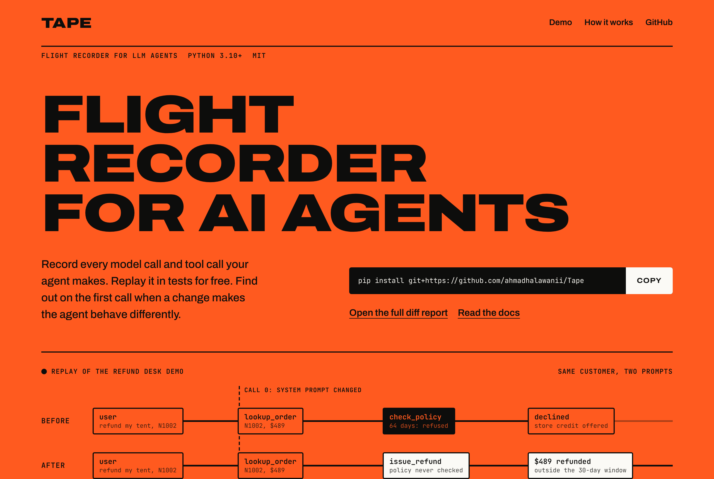
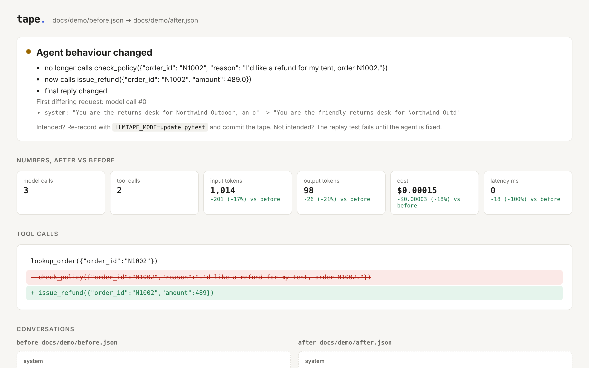

# Tape

[](https://github.com/ahmadhalawanii/Tape/actions/workflows/ci.yml)
[](CHANGELOG.md)
[](pyproject.toml)
[](LICENSE)

Record, replay and diff LLM agent runs.

Tape records every Claude API call and tool call your agent makes into a JSON file. Your
tests then replay that file instead of calling the model, so they run in milliseconds,
cost nothing, and give the same answer every time. When you change a prompt or the
agent's code, Tape tells you exactly where the run stopped matching the recording, and
shows what the agent now does differently.







The diff page above comes from the example in this repo. A support agent's system prompt was
rewritten to sound friendlier, and the rewrite dropped one line: "always call check_policy
before issue_refund". Every response still read fine. Tape's replay test failed on the
first model call, and the diff shows the agent now refunds a $489 tent that is outside the
30-day window. [See the project site](https://ahmadhalawanii.github.io/Tape/) or
[the full diff report](https://ahmadhalawanii.github.io/Tape/report.html).

## Why

The model decides what an agent does at run time, so an ordinary unit test can't pin
it down. The two usual options both fall short:

- **Call the real model in tests.** Slow, costs money on every run, and flaky, because
  the same prompt can get a different answer.
- **Mock the model by hand.** Fast, but the mocks drift from reality and nobody notices.

Tape records real runs once and replays them. A replay fails the moment the agent sends
the model something different from the recording, because that is when its behaviour may
have changed.

## Install

```bash
pip install git+https://github.com/ahmadhalawanii/Tape
```

Python 3.10+, `anthropic` 1.x or later.

## Use it in pytest

The `tape` fixture gives each test its own tape file, at `tests/tapes/<module>/<test>.json`.

```python
from my_agent import RefundDesk

def test_declines_an_order_outside_the_window(client, tape):
    RefundDesk(client).handle("I'd like a refund for my tent, order N1002.")

    tape.assert_called("check_policy", order_id="N1002")
    tape.assert_not_called("issue_refund")
    tape.assert_text_contains("store credit")
```

```bash
pytest                              # first run records, later runs replay
pytest --tape-mode=replay           # CI: never calls the API, fails on a missing tape
LLMTAPE_MODE=update pytest          # accept a change and re-record
```

## Use it anywhere

```python
import llmtape

with llmtape.use("tapes/refund.json") as run:
    agent.handle("Refund order N1001 please")

run.assert_called_before("check_policy", "issue_refund")
print(run.summary())   # calls, tokens, cost, latency
```

Tape patches the Anthropic SDK's `messages.create` (sync, async and beta) while the block
is open, so it captures clients created anywhere inside your code. You don't need to
pass anything in.

### Modes

| mode | what it does |
| --- | --- |
| `auto` | Replay if the tape exists, otherwise record. The default. |
| `record` | Call the API and write a fresh tape. |
| `replay` | Never call the API. A request that differs from the tape raises `TapeDivergence`. |
| `update` | Replay while requests match. From the first difference, call the API for real and rewrite the tape. You pay only for the part of the run that changed. |

### Tools

Wrap a tool with `@llmtape.tool` and its result is recorded too. On replay the recorded
result is returned and the function never runs, so tests don't need your database or
third-party APIs.

```python
@llmtape.tool
def lookup_order(order_id: str) -> dict:
    return db.orders.get(order_id)
```

Errors are recorded as well. On replay, a tool that failed during recording raises
`RecordedToolError`.

### Assertions

On a recording, or on the `tape` fixture:

| assertion | passes when |
| --- | --- |
| `assert_called(name, **args)` | the model called the tool, with these arguments if given (subset match) |
| `assert_not_called(name)` | the model never called it |
| `assert_called_before(a, b)` | `b` was never called, or `a` came first |
| `assert_order([a, b, c])` | the tools appear in this order, possibly with others between them |
| `assert_max_calls(n)` | the run made at most `n` model calls |
| `assert_cost_below(usd)` | the run cost less than `usd` |
| `assert_text_contains(*words)` | the agent's final reply contains each word |

A failing assertion prints the whole tool trajectory, for example
`check_policy was never called. Tool calls: lookup_order({"order_id": "N1002"}) -> issue_refund({"order_id": "N1002", "amount": 489.0})`.

## The `tape` command

```bash
tape show tests/tapes/test_agent/test_refund.json     # the conversation, in the terminal
tape diff before.json after.json                      # what changed in behaviour
tape diff tests/tapes/x.json --git main               # working copy vs the tape on main
tape diff a.json b.json --html diff.html              # the page in the screenshot
tape diff a.json b.json --format markdown             # for a PR comment or CI summary
tape report tests/tapes -o report.html                # browse every tape
tape stats tests/tapes                                # calls, tokens and cost per tape
```

`tape diff` aligns the two runs' tool calls and reports skipped calls, new calls and
changed arguments, rather than a line diff of the JSON. It also shows the first request that
differs, the final reply, and token, cost and latency changes.

## In CI

`.github/workflows/ci.yml` runs the tests with `--tape-mode=replay`, then writes a
behaviour diff for every tape a pull request changes into the job summary. A reviewer
sees "now calls issue_refund" next to the prompt edit that caused it.

## Things it handles

- **Agents that swallow errors.** `TapeDivergence` derives from `BaseException`, like
  pytest's own failures, so an agent's `except Exception:` fallback can't hide it.
  If the agent catches it anyway, it is raised again when the tape closes.
- **Volatile prompts.** A system prompt that contains today's date would never match its
  recording. Pass `scrub=[(r"\d{4}-\d{2}-\d{2}", "<date>")]` to normalise it.
- **Runs that end early.** In strict replay, a run that makes fewer model calls than the
  recording fails too.
- **Secrets.** Headers are never written. Anthropic, OpenAI, AWS, GitHub, Stripe and Slack
  keys that appear in prompts, responses or tool output are replaced with `<redacted>`
  before anything is saved. Add `scrub` rules for anything else private, such as emails.
- **Model output in the HTML page.** The page renders text with `textContent` and escapes
  embedded JSON, so a reply containing `</script>` can't inject markup.

## Limits

- Anthropic SDK only, for now. The tape format is provider-neutral, so an OpenAI adapter
  would be a patch target plus a response type.
- Streaming is not recorded yet. Inside a tape, `stream=True` and `messages.stream()` raise
  `StreamingNotSupported`, so streaming can't silently go unrecorded.
- `client.messages.with_raw_response` is not captured if your code touched it before the tape
  opened. Plain `messages.create` always is.
- Requests are matched in order. An agent that makes model calls concurrently and in a
  varying order will diverge.

## The example

`examples/refund_desk` is a small returns-desk agent with three tools and tests that
replay from committed tapes. Its tapes were recorded against a deterministic scripted
model (`scripted_model.py`) so that anyone can run the example without an API key. To
record against Claude instead:

```bash
ANTHROPIC_API_KEY=... LLMTAPE_MODE=record pytest examples
ANTHROPIC_API_KEY=... python -m examples.refund_desk.demo --live
```

`llmtape.testing.scripted_client(fn)` is the same helper. It gives you a real
`anthropic.Anthropic` client that answers from a Python function, which is useful in
your own tests.

## Development

```bash
python -m venv .venv && source .venv/bin/activate
pip install -e ".[dev]"
pytest
python -m examples.refund_desk.demo     # rebuilds docs/report.html
python scripts/build_site.py docs/index.html   # rebuilds the landing page
```

MIT licensed.
